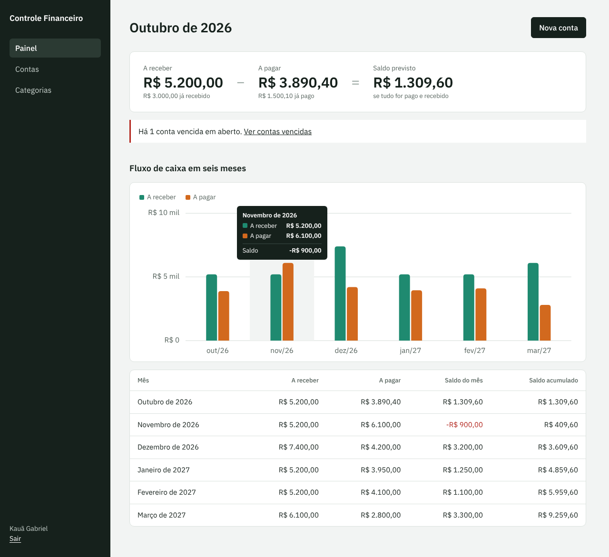
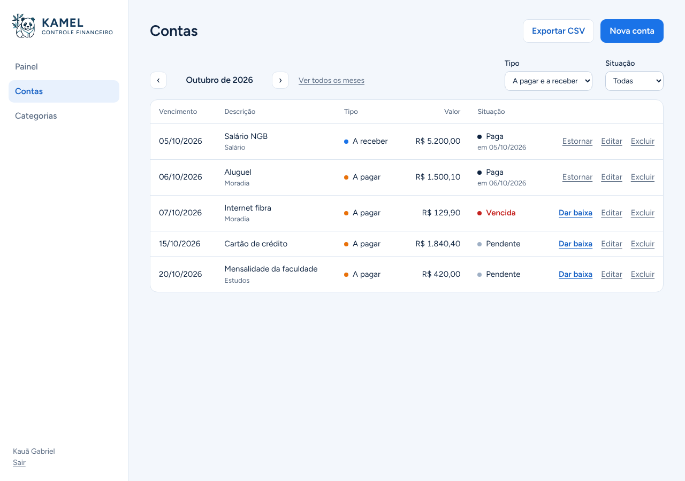

# Kamel Controle Financeiro

Sistema de contas a pagar e a receber com fluxo de caixa por período. API em Laravel com PostgreSQL e front-end em React.





As imagens mostram o sistema com dados de exemplo.

## Tecnologias

- PHP 8.3 e Laravel 13
- PostgreSQL 16
- Docker e Docker Compose
- Laravel Sanctum para autenticação por token
- React 19 com Vite e React Router
- PHPUnit, Vitest, Playwright e GitHub Actions

## Como rodar

Pré-requisitos: [Docker Desktop](https://www.docker.com/products/docker-desktop/) e Git.

```bash
git clone https://github.com/Kauagabriel1026/controle-financeiro.git
cd controle-financeiro
docker compose up --build
```

Na primeira execução os contêineres instalam as dependências, geram a chave da aplicação e criam as tabelas no banco. Depois disso:

- Sistema: `http://localhost:5173`
- API: `http://localhost:8000/api`

Abra o sistema, clique em **Criar conta** e cadastre um usuário para começar.

Para conferir só a API, acesse `http://localhost:8000/api/health`. A resposta esperada é:

```json
{ "status": "ok", "banco": "pgsql" }
```

## API

Todas as rotas ficam em `http://localhost:8000/api`. As rotas marcadas com 🔒 exigem o cabeçalho `Authorization: Bearer <token>`, com o token devolvido no cadastro ou no login.

### Autenticação

| Método | Rota | O que faz |
| --- | --- | --- |
| POST | `/registrar` | Cria o usuário e devolve um token |
| POST | `/login` | Devolve um token |
| GET | `/eu` 🔒 | Dados do usuário logado |
| POST | `/logout` 🔒 | Invalida o token usado |

### Categorias 🔒

| Método | Rota | O que faz |
| --- | --- | --- |
| GET | `/categorias` | Lista as categorias do usuário |
| POST | `/categorias` | Cria uma categoria |
| PUT | `/categorias/{id}` | Renomeia uma categoria |
| DELETE | `/categorias/{id}` | Exclui uma categoria |

### Contas 🔒

| Método | Rota | O que faz |
| --- | --- | --- |
| GET | `/contas` | Lista as contas, com paginação e filtros |
| POST | `/contas` | Cria uma conta a pagar ou a receber |
| GET | `/contas/{id}` | Mostra uma conta |
| PUT | `/contas/{id}` | Edita uma conta |
| DELETE | `/contas/{id}` | Exclui uma conta |
| POST | `/contas/{id}/pagar` | Dá baixa no pagamento |
| POST | `/contas/{id}/estornar` | Desfaz a baixa |

Filtros de `GET /contas`: `tipo` (`pagar` ou `receber`), `status` (`pendente`, `paga` ou `vencida`), `de` e `ate` (período de vencimento, no formato `AAAA-MM-DD`).

Cada usuário só enxerga as próprias contas e categorias. O status é calculado: `paga` quando há data de pagamento, `vencida` quando o vencimento já passou e `pendente` nos demais casos.

### Fluxo de caixa 🔒

| Método | Rota | O que faz |
| --- | --- | --- |
| GET | `/fluxo-caixa` | Totais por mês de vencimento, com saldo e saldo acumulado |

Parâmetros opcionais: `de` e `ate`, no formato `AAAA-MM-DD`. Sem eles, o período é o mês atual mais os cinco seguintes. Para cada mês a resposta traz o previsto (`receber`, `pagar`, `saldo`, `saldo_acumulado`) e o realizado (`recebido`, `pago`).

Exemplo de criação de conta:

```bash
curl -X POST http://localhost:8000/api/contas \
  -H "Authorization: Bearer SEU_TOKEN" \
  -H "Content-Type: application/json" \
  -H "Accept: application/json" \
  -d '{"tipo":"pagar","descricao":"Aluguel","valor":1500,"vencimento":"2026-11-10"}'
```

## Comandos úteis

```bash
# Rodar os testes da API
docker compose exec api php artisan test

# Rodar os testes do front-end
docker compose exec web npm test

# Rodar o teste de ponta a ponta (com o sistema no ar; baixa um navegador na primeira vez)
cd web && npm install && npx playwright install chromium && npm run test:e2e

# Criar as tabelas do zero
docker compose exec api php artisan migrate:fresh

# Parar tudo
docker compose down
```

## Estrutura

```
├── api/                  # API em Laravel
│   ├── app/              # Models, controllers e regras de negócio
│   ├── database/         # Migrations, factories e seeders
│   ├── routes/api.php    # Rotas da API
│   ├── tests/            # Testes automatizados
│   └── Dockerfile
├── web/                  # Front-end em React
│   └── src/
│       ├── pages/        # Telas: login, painel, contas e categorias
│       ├── components/   # Layout, formulário de conta e gráfico
│       ├── api.js        # Chamadas à API, com o token do usuário
│       └── auth.jsx      # Sessão do usuário logado
├── docker-compose.yml    # Sobe a API, o PostgreSQL e o front-end
└── .github/workflows/    # Testes automáticos a cada push
```

## Etapas

- [x] Base do projeto: Laravel, PostgreSQL, Docker e testes automáticos
- [x] Banco de dados: categorias e contas
- [x] API de contas a pagar e a receber, com baixa de pagamento
- [x] Login, com cada usuário vendo só as próprias contas
- [x] Fluxo de caixa por período
- [x] Front-end em React
